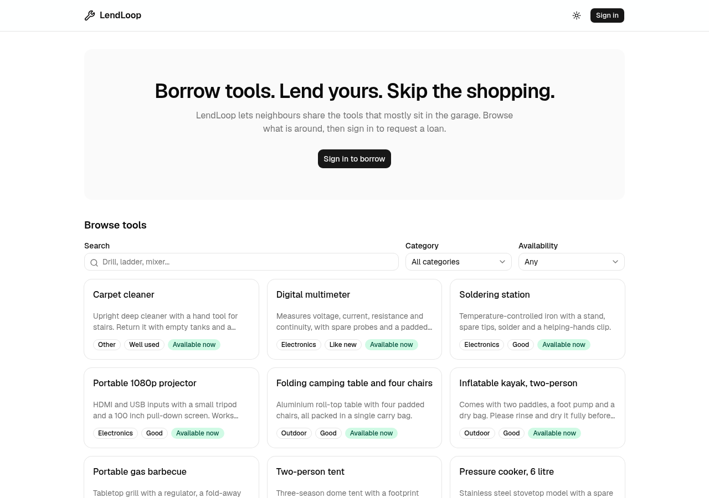
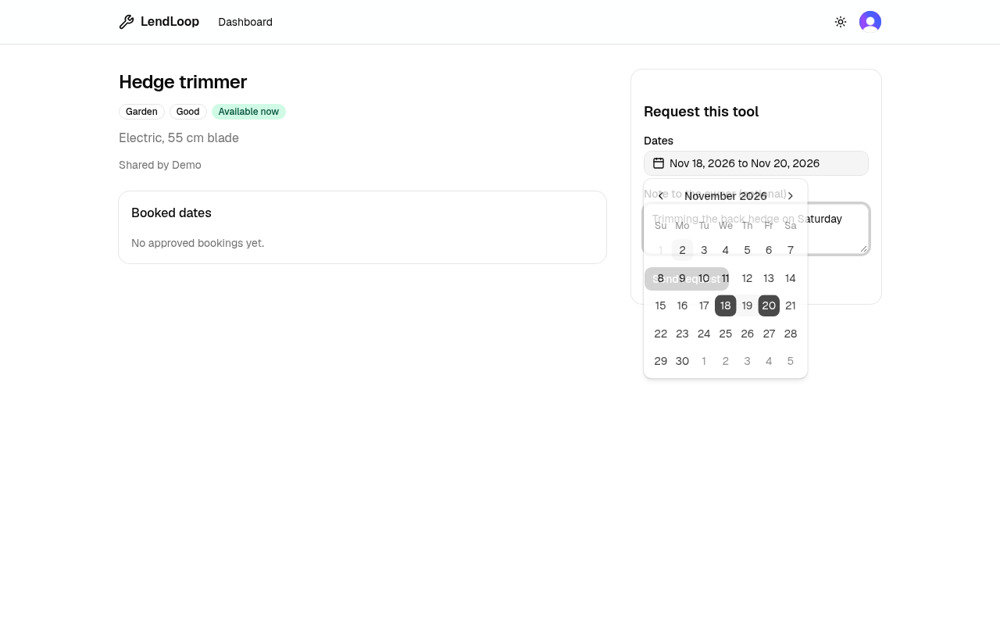
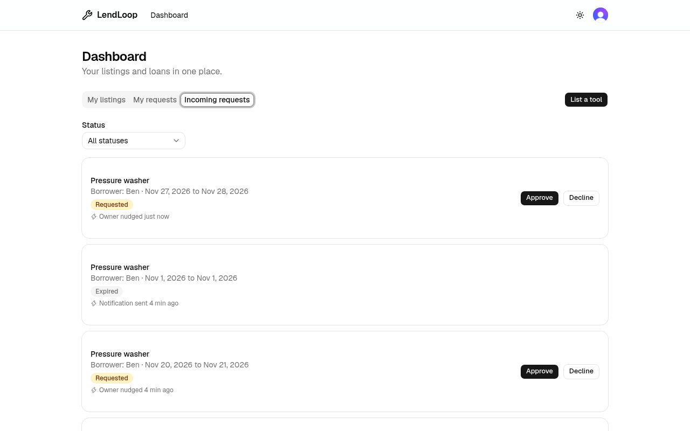
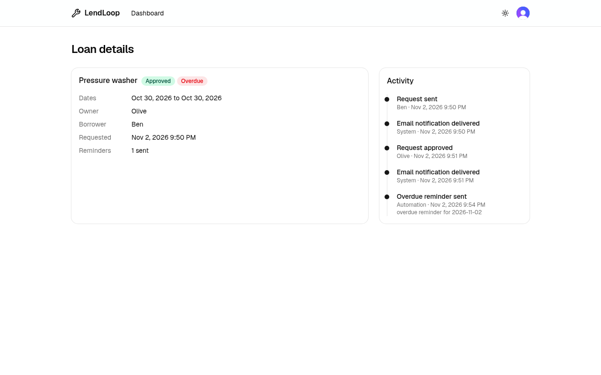
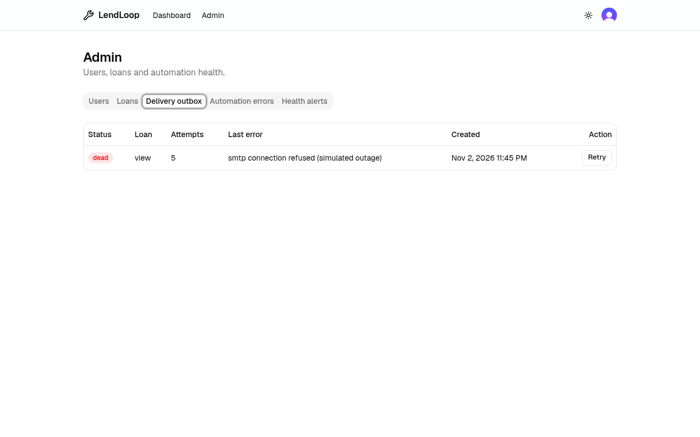
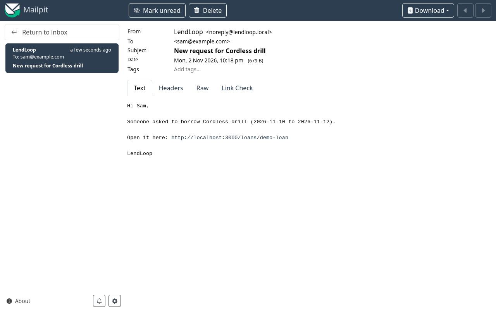
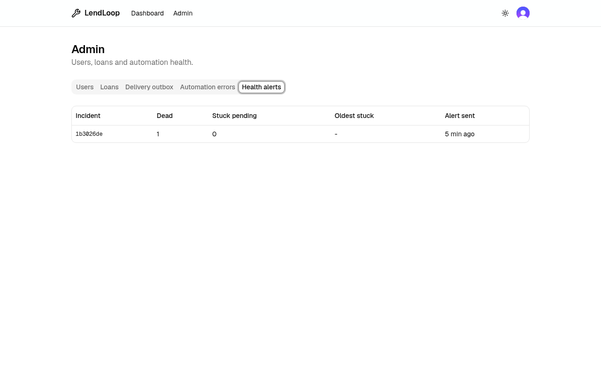
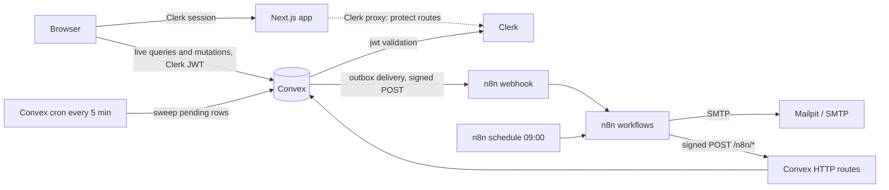
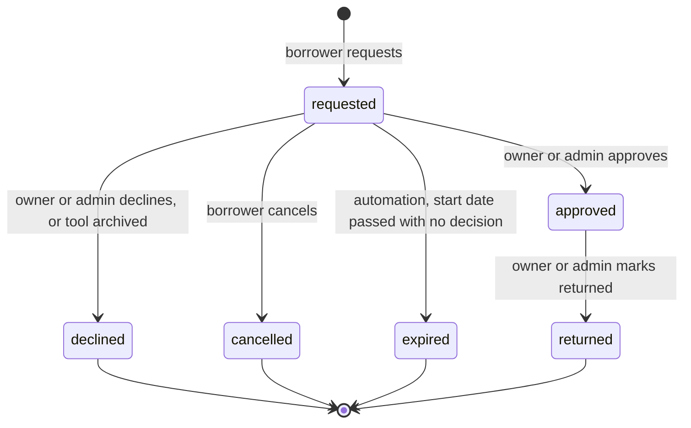

# LendLoop

[](https://github.com/t-nielzon/lendloop/actions/workflows/ci.yml)

LendLoop is a small community tool-lending app. Neighbours list tools they are willing to lend, other members request a date range, owners approve or decline, and everyone is kept informed by email. The web app is Next.js 16 (App Router) with Clerk for sign-in and Convex for data and server logic. A self-hosted n8n instance sends the emails and runs the scheduled reminder, follow-up and health-check jobs, and talks to Convex only through signed HTTP calls.

Features:

- Public catalog with search, category and availability filters. It never shows who owns a tool.
- Tool pages with booked date ranges and the next free date.
- Loan requests with date validation, a 30-day maximum span and overlap protection against approved loans.
- Owner dashboard: incoming requests, approve, decline, mark returned. Borrower view: my requests, cancel.
- Loan detail page with a full event timeline, including notification and reminder events written back by n8n.
- Email notifications on every status change, delivered through an outbox with retries and a dead-letter state.
- Daily overdue reminders, at most one per loan per day, plus a pickup reminder the day before a loan starts and a nudge to the owner when a request waits more than 48 hours.
- Requests that nobody decided before their start date expire automatically and the borrower is notified.
- Automation activity on each loan: the latest event shows on every row ("Reminder sent 2 days ago") and in full on the timeline.
- Delivery health alerts: an email to the alert address when notifications are dead or stuck, listed in the admin console.
- Admin console: delivery outbox with manual retry, health alerts, workflow failures reported by n8n, all loans, user roles.

## Screenshots

| Catalog | Tool detail and request |
|-|-|
|  |  |

| Incoming requests | Loan timeline with reminder |
|-|-|
|  |  |

| Admin outbox | Notification email in Mailpit |
|-|-|
|  |  |

| Admin health alerts |
|-|
|  |

## Hosted demo

https://lendloop.nielzontolentino.com (being set up) runs the app on Netlify with a Convex cloud deployment and a Clerk development instance. n8n is not hosted there, so status notifications queue in the outbox and show as pending in the admin console. The full automation path (emails, reminders, follow-ups, health alerts) runs in the local docker-compose stack described below.

## Quick start

### Prerequisites

- Node.js 20 or newer, and pnpm 10 (`corepack enable` will pick up the version pinned in `package.json`).
- Docker with the compose plugin, and `openssl` (used by the setup script).
- A free Clerk account.

### 1. Start the local stack

```bash
pnpm install
scripts/setup-local.sh
```

The script creates `.env` from `.env.example` if it is missing, generates the HMAC secrets and the n8n encryption key (it never overwrites values you already set), runs `docker compose up -d --wait`, generates a Convex admin key and prints the exact commands for the next steps.

| Service | URL |
|-|-|
| Convex API / HTTP actions | http://127.0.0.1:3210 / http://127.0.0.1:3211 |
| Convex dashboard | http://localhost:6791 |
| n8n | http://localhost:5678 |
| Mailpit (captured email) | http://localhost:8025 |

The `n8n-import` one-shot container loads the Mailpit SMTP credential and the six workflows from `n8n/`, then publishes all six workflows, including the error handler, before n8n starts. No manual import is needed.

### 2. Create the Clerk development app

1. Create an application in the Clerk dashboard with email sign-in.
2. In the dashboard, activate the Convex integration (or create a JWT template named exactly `convex`). Convex expects the application ID `convex`.
3. Copy the Frontend API / issuer URL of the template, for example `https://example.clerk.accounts.dev`. This is `CLERK_JWT_ISSUER_DOMAIN`.
4. Create `.env.local` (git-ignored) with the keys, the Convex URL and the two Convex CLI variables. The admin key is printed by `scripts/setup-local.sh` (re-run the script to print it again; it is safe to repeat):

```bash
NEXT_PUBLIC_CONVEX_URL=http://127.0.0.1:3210
NEXT_PUBLIC_CLERK_PUBLISHABLE_KEY=pk_test_...
CLERK_SECRET_KEY=sk_test_...
CONVEX_SELF_HOSTED_URL=http://127.0.0.1:3210
CONVEX_SELF_HOSTED_ADMIN_KEY=<admin key>
```

### 3. Set the Convex environment, then push the functions

Set the deployment variables first: the functions load `auth.config.ts` at push time and need `CLERK_JWT_ISSUER_DOMAIN`, so the first push fails without it. The Convex CLI reads the two `CONVEX_SELF_HOSTED_*` values from `.env.local`. The secrets must be the same values as in `.env`:

```bash
set -a; . ./.env; set +a
npx convex env set CLERK_JWT_ISSUER_DOMAIN 'https://example.clerk.accounts.dev'
npx convex env set ADMIN_EMAILS 'you@example.com'
npx convex env set APP_URL 'http://localhost:3000'
npx convex env set N8N_LOAN_STATUS_WEBHOOK_URL 'http://n8n:5678/webhook/lendloop/loan-status'
npx convex env set LENDLOOP_OUTBOUND_SECRET "$LENDLOOP_OUTBOUND_SECRET"
npx convex env set LENDLOOP_INBOUND_SECRET "$LENDLOOP_INBOUND_SECRET"
```

The webhook URL uses the compose service name because the Convex backend runs in the same compose network as n8n. Then push the functions and leave this running in its own terminal (`pnpm dev:convex` is the same command):

```bash
npx convex dev
```

If you ran `npx convex dev` before setting the variables, stop it and start it again after the `env set` commands.

### 4. Run the app

```bash
pnpm dev
```

Open http://localhost:3000. If `next dev` crashes with "OS file watch limit reached" (another process is using up the inotify watches), build and serve instead: `pnpm build && pnpm start`. On such hosts the Convex CLI may also need `CHOKIDAR_USEPOLLING=1 npx convex dev`.

### 5. Seed data

Load a lived-in demo neighbourhood: ten neighbours, 28 tools across every category (two archived) and 35 loans in every state (including one expired), with dates relative to today and a full event timeline for each:

```bash
npx convex run seed:demo       # inserts only if the seed neighbours do not exist yet
npx convex run seed:resetDemo  # deletes seed-owned data and reseeds with fresh dates
```

The seed neighbours use `example.com` addresses and a `seed|` token prefix, so they cannot sign in and nobody can be emailed. Nobody can approve requests for their tools as the owner, so evaluators can sign in as an admin (see below) and approve or decline those requests from the loan page or the admin Loans tab, or list their own tools with a second account and use the normal owner flow. Seeding writes documents directly and never queues notification deliveries. `seed:demo` is safe to repeat; `seed:resetDemo` touches only seed users, their tools, loans on those tools or by those users, and their events; it also removes the older `seed:demoTools` placeholder owner.

The older `seed:demoTools` (five tools owned by a single placeholder member) still works.

These are internal functions, so they can only be run through the CLI. To try the overdue reminder, approve a loan in the UI, then move its end date into the past (use the loan id from its page):

```bash
npx convex run seed:backdateLoan '{"loanId": "<loan id>", "endDate": "2026-01-01"}'
```

Then run "Execute workflow" on the daily reminders workflow in n8n and check Mailpit and the loan timeline.

### Test users and becoming admin

Clerk development instances accept test addresses: any email containing `+clerk_test`, for example `alice+clerk_test@example.com`, signs up with the verification code `424242`. Create at least two users (an owner and a borrower) to exercise the full flow.

Admin is never granted from the client. To become admin, put your address in `ADMIN_EMAILS` (comma separated, case-insensitive) before your first sign-in, and sign in with a verified email address. For example, set `ADMIN_EMAILS` to `admin+clerk_test@example.com` and sign up with that address. If the user already exists, change the role from the admin console as another admin, or edit the `role` field in the Convex dashboard. The allowlist only applies when a user row is first created.

### Trying the n8n flow

1. Sign in as user A, create a tool. Sign in as user B (another browser profile), request it.
2. Open Mailpit at http://localhost:8025. User A receives "New request for ...".
3. Approve as user A. User B receives the approval. The loan timeline shows `notification_delivered`.
4. To see failure handling, stop n8n (`docker compose stop n8n`), change a loan status, and look at the admin outbox: the row stays pending with a retry time. Start n8n again and it is delivered by the next retry or the 5-minute sweep.

### Troubleshooting

- If `next dev` crashes with "OS file watch limit reached", run `pnpm build && pnpm start` instead. The Convex CLI may need `CHOKIDAR_USEPOLLING=1`. After another `pnpm build`, restart `pnpm start` so it serves the new chunks.
- Outbox rows stay pending with "webhook url not configured" or "outbound secret not configured": the Convex env variables from step 3 are missing. Set them; the next sweep picks the rows up. No attempt is consumed while config is missing.
- Webhook answers 401: the secret in the n8n container differs from the one in Convex, or the clocks differ by more than 5 minutes.
- After editing a workflow JSON, run `docker compose run --rm n8n-import && docker compose restart n8n`; activation only takes effect on restart.

## Environment variables

| Variable | Where it lives | Secret | Purpose |
|-|-|-|-|
| `NEXT_PUBLIC_CONVEX_URL` | Web app (`.env.local`) | No | Convex deployment URL used by the browser |
| `NEXT_PUBLIC_CLERK_PUBLISHABLE_KEY` | Web app | No | Clerk publishable key |
| `CLERK_SECRET_KEY` | Web app | Yes | Clerk server key used by the Clerk proxy (`src/proxy.ts`) |
| `CONVEX_SELF_HOSTED_URL`, `CONVEX_SELF_HOSTED_ADMIN_KEY` | Shell / `.env.local` for the Convex CLI | Admin key: yes | Point `convex dev` at the self-hosted backend |
| `CLERK_JWT_ISSUER_DOMAIN` | Convex deployment | No | Issuer of the `convex` JWT template, used to validate tokens |
| `ADMIN_EMAILS` | Convex deployment | No | Allowlist for the first-sign-in admin role |
| `APP_URL` | Convex deployment | No | Origin used to build links in emails |
| `N8N_LOAN_STATUS_WEBHOOK_URL` | Convex deployment | No | Where the outbox delivers status changes |
| `LENDLOOP_OUTBOUND_SECRET` | Convex deployment and n8n container (compose `.env`) | Yes | Signs Convex to n8n requests |
| `LENDLOOP_INBOUND_SECRET` | Convex deployment and n8n container (compose `.env`) | Yes | Signs n8n to Convex requests |
| `LENDLOOP_OUTBOUND_SECRET_PREVIOUS` | n8n container (compose `.env`) | Yes | Optional, rotation only: old Convex to n8n secret that n8n still accepts. Leave empty otherwise |
| `LENDLOOP_INBOUND_SECRET_PREVIOUS` | Convex deployment | Yes | Optional, rotation only: old n8n to Convex secret that Convex still accepts. Leave empty otherwise |
| `N8N_HOST_PORT` | Compose `.env` | No | Host port for the n8n UI and webhook (default `5678`) |
| `MAILPIT_HTTP_PORT`, `MAILPIT_SMTP_PORT` | Compose `.env` | No | Host ports for the Mailpit UI and SMTP (defaults `8025`, `1025`) |
| `N8N_ENCRYPTION_KEY` | Compose `.env` | Yes | Encrypts n8n credentials at rest; generated by the setup script |
| `LENDLOOP_CONVEX_SITE_URL` | Compose `.env`, n8n container | No | Convex HTTP actions origin as seen from n8n (default `http://convex-backend:3211`) |
| `LENDLOOP_ALERT_EMAIL` | Compose `.env`, n8n container | No | Recipient of workflow failure alerts |
| `GENERIC_TIMEZONE` | Compose `.env`, n8n container | No | Timezone of the schedules and of the reminder dates (default `UTC`) |

Two different places hold the same two secrets on purpose: they are provisioned twice (compose `.env` and `npx convex env set`) because the two systems share no secret store locally. `.env` is git-ignored.

## Architecture



The browser talks to Convex directly with a Clerk-issued JWT; every query and mutation checks the viewer inside Convex. Next.js only serves pages and runs the Clerk proxy (`src/proxy.ts`) that requires sign-in for everything except `/`, `/sign-in` and `/sign-up`.

Loan transitions write the loan, a `loanEvents` row and an `outbox` row in one Convex transaction, then schedule delivery. Convex signs and POSTs the outbox payload to n8n; n8n verifies, sends the email and answers 200. Failures are retried with backoff by Convex, and a cron sweep recovers rows left pending. For overdue loans, n8n asks Convex for the list, emails each borrower and writes each send back with an idempotency key.

Convex HTTP routes (all `POST`, all signed, on the site origin):

| Route | Caller | Purpose |
|-|-|-|
| `/n8n/overdue-loans` | n8n | Returns approved loans past their end date that were not reminded today, one page of up to 200, plus `hasMore` |
| `/n8n/reminder-sent` | n8n | Records a sent reminder once per `overdue-reminder:<loanId>:<date>` key |
| `/n8n/workflow-error` | n8n | Stores a failed execution so admins see it |

The data model, outbox mechanics and sequence diagrams are in [docs/ARCHITECTURE.md](docs/ARCHITECTURE.md).

Code layout: `src/app` pages, `src/components` UI, `convex/` backend (`lib/` holds auth, signing, dates, loan flow and view shaping), `n8n/` workflows, credentials, import script and workflow tests, `scripts/` local setup and a request signer.

## Roles and permissions

| Action | Anonymous | Member | Tool owner | Admin |
|-|-|-|-|-|
| Browse public catalog (no owner shown) | Yes | Yes | Yes | Yes |
| See owner first name and booked ranges | No | Yes | Yes | Yes |
| See who booked a tool | No | No | Yes | Yes |
| Create a tool | No | Yes | Yes | Yes |
| Edit or archive a tool | No | No | Own tools | Any |
| Request a loan | No | Yes (not own tool) | No (own tool) | Yes (not own tool) |
| Cancel a request | No | Borrower only | n/a | Only as the borrower, not for others |
| Approve, decline, mark returned | No | No | Own tools | Any (loan page and admin Loans tab) |
| View a loan and its timeline | No | Participants only | Yes | Any |
| Outbox, retry, workflow errors, all loans | No | No | No | Yes |
| List users and change roles | No | No | No | Yes, not own role |

All of this is enforced in Convex functions (`requireUser`, `requireAdmin` and ownership checks), not in the UI. The UI hides controls for convenience only.

## Loan state machine



Rules enforced on the server:

- Requests need an active tool that the viewer does not own, valid `YYYY-MM-DD` dates, a start date not in the past, an end date not before the start, a span of at most 30 days, a note of at most 500 characters, no overlap with an approved loan, and no duplicate open request by the same borrower for overlapping dates.
- Approval re-checks overlap, that the tool is still active and that the start date has not passed, since another request may have been approved in the meantime.
- Archiving a tool declines its open requests (with a "tool archived" event) and notifies the borrowers.
- An approved loan whose end date has passed is shown as overdue and keeps the tool unavailable until it is returned.
- `expired` is set only by the stale-request workflow through Convex, never by a user. It applies to a still-requested loan whose start date has passed; if the owner decided first the call is skipped.
- Every transition writes an audit event and queues a notification: `requested` and `cancelled` go to the owner, the others to the borrower.

## n8n workflows

Exported JSON lives in `n8n/workflows/` with fixed ids, so re-importing updates in place.

| Workflow | Trigger | What it does | Write-back and idempotency key | Failure handling |
|-|-|-|-|-|
| Loan status notification | Webhook `POST /webhook/lendloop/loan-status` | Verifies the signature on the raw body, rejects invalid payloads, sends the status email, answers 200 | None to Convex (Convex records delivery from the 200). Dedupe by `eventId` in static data, recorded after the send | A failed send answers 500 so the outbox retries |
| Daily overdue reminders | Schedule `0 9 * * *`, plus manual | Calls `/n8n/overdue-loans`, one email per borrower, pages while `hasMore` (maximum 10 pages) | `/n8n/reminder-sent`, key `overdue-reminder:<loanId>:<date>` | Per-loan failures are recorded and skipped; the run fails at the end if any failed |
| Pickup reminders | Schedule `0 8 * * *`, plus manual | Calls `/n8n/upcoming-pickups` for approved loans starting tomorrow, emails borrower and owner, pages while `hasMore` (maximum 10 pages) | `/n8n/pickup-reminder-sent`, key `pickup-reminder:<loanId>:<date>`, written only after both emails went out | Same per-loan isolation and end-of-run failure |
| Stale request follow-up | Schedule `0 10 * * *`, plus manual | Calls `/n8n/stale-requests`. Requests undecided for 48 hours or more get one email to the owner; requests whose start date has passed are expired through Convex, which notifies the borrower | Nudge: `/n8n/request-nudged`, key `request-nudge:<loanId>`. Expiry: `/n8n/expire-request`, key `request-expire:<loanId>`; `skipped` (owner decided first) counts as success | Same per-item isolation and end-of-run failure |
| Delivery health monitor | Schedule every 15 minutes, plus manual | Calls `/n8n/delivery-health`; when dead or stuck notifications exist and the incident was not alerted yet, emails `LENDLOOP_ALERT_EMAIL` | `/n8n/health-alert-sent`, key `health-alert:<incidentKey>`; the incident key is remembered in static data (last 100) only after the write-back | A failed email or write-back fails the run |
| Error handler | Error trigger | Reports the failure to `/n8n/workflow-error`, then emails `LENDLOOP_ALERT_EMAIL` | `workflow-error:<executionId>` | Its two steps retry 3 times and continue on error |

All five other workflows name the error handler as their error workflow. The loan status notification is the one exception in practice: it catches its own email failure and answers 500, so the failure stays with the Convex outbox (retries, then dead letter) and the delivery health monitor alerts on it, rather than firing the error handler.

Reliability:

- Retries: HTTP nodes retry 3 times and email nodes 2 times with a 3 to 5 second wait. The error handler's two steps retry 3 times and continue on error, so an email outage never loses the Convex record.
- Idempotency: status events are deduplicated by `eventId`, which is only recorded after the email went out (a crash between sending and recording can cause one duplicate email, never a lost one). The write-backs use deterministic keys (listed in the table) that Convex stores as receipts, so a retried write-back is a no-op.
- Isolation: in the reminder and follow-up loops a failed address or write-back is recorded and the loop continues with the next borrower.
- Convex side: a non-2xx or timeout from n8n is retried by the outbox (see [docs/ARCHITECTURE.md](docs/ARCHITECTURE.md)).

Import and export:

```bash
# import (also what the n8n-import container runs); ids are fixed, so this upserts
docker compose run --rm n8n-import && docker compose restart n8n

# export after editing in the n8n UI at http://localhost:5678
docker compose exec n8n n8n export:workflow --all --separate --output=/tmp/wf
docker compose cp n8n:/tmp/wf/. n8n/workflows/
```

Exports contain no secrets: the workflows read `$env.LENDLOOP_*` at run time and the SMTP credential is imported separately from `n8n/credentials/`. Check a fresh export for credential data before committing it. Imported workflows are inactive in the JSON; `n8n/import.sh` publishes all six, including the error handler, which n8n only runs once it is published.

Trigger manually:

```bash
# status webhook: prints a signed curl command for a sample payload
node scripts/sign-request.mjs "$LENDLOOP_OUTBOUND_SECRET" http://localhost:5678/webhook/lendloop/loan-status | sh

# overdue reminders: back-date an approved loan (see Seed data), then open the workflow in the n8n UI and use "Execute workflow"
# the other three scheduled workflows have a manual trigger too: open them in the n8n UI and use "Execute workflow"
```

A second run of the sample curl with the same `eventId` returns `{"status":"duplicate"}`. Pass your own body as the third argument, or `--timestamp <unix-seconds>` with an old value to see the 401 for a stale request.

## Rotating the signing secrets

Each direction accepts a current and an optional previous secret, so a rotation needs no downtime. Signing always uses the current secret. Verification tries both in constant time, and an empty previous secret is ignored. Generate new values with `openssl rand -hex 32`. Compose reads `.env` only when a container is created, so use `up -d` (not `restart`) after editing it.

Outbound (Convex to n8n):

```bash
# 1. n8n accepts the new secret as current and the old one as previous
#    in the compose .env: LENDLOOP_OUTBOUND_SECRET=<new>, LENDLOOP_OUTBOUND_SECRET_PREVIOUS=<old>
docker compose up -d n8n
# 2. Convex starts signing with the new secret
npx convex env set LENDLOOP_OUTBOUND_SECRET '<new>'
# 3. once the outbox has no deliveries signed with the old secret, clear LENDLOOP_OUTBOUND_SECRET_PREVIOUS in .env
docker compose up -d n8n
```

Inbound (n8n to Convex):

```bash
# 1. Convex accepts the new secret as current and the old one as previous
npx convex env set LENDLOOP_INBOUND_SECRET_PREVIOUS '<old>'
npx convex env set LENDLOOP_INBOUND_SECRET '<new>'
# 2. n8n starts signing with the new secret: set LENDLOOP_INBOUND_SECRET=<new> in the compose .env
docker compose up -d n8n
# 3. after the next scheduled runs succeed, remove the previous secret from Convex
npx convex env remove LENDLOOP_INBOUND_SECRET_PREVIOUS
```

Verify the outbound window locally with `scripts/n8n-smoke.sh`, which checks that the previous secret is accepted.

## Security decisions

- Request signing. Both directions use `HMAC-SHA256` over `<unix timestamp>.<raw body>`, sent as `X-LendLoop-Signature: v1=<hex>` with `X-LendLoop-Timestamp`. Requests more than 300 seconds off the server clock are rejected in both directions, which limits replay. The signature is checked on the raw body bytes before any JSON parsing.
- Constant-time comparison. Signatures are compared without early exit in Convex and with `timingSafeEqual` in n8n.
- Dual-secret rotation. Either side accepts a previous secret during a rotation window; see the runbook above.
- Separate secrets per direction. `LENDLOOP_OUTBOUND_SECRET` (Convex to n8n) and `LENDLOOP_INBOUND_SECRET` (n8n to Convex) are different, so a leak of one does not allow forging the other direction.
- Fail closed. A missing secret fails verification on both sides (401); on the Convex sender a missing secret or URL defers the delivery instead of sending unsigned.
- Size limits. Inbound HTTP bodies are capped at 64 KiB, counted while streaming so a missing or false `Content-Length` does not bypass the cap. Fields are length checked and stored error messages are truncated.
- Authorization lives in Convex. Every function re-derives the viewer from the Clerk token and checks role or ownership. Roles are never taken from client input.
- Admin bootstrap. `ADMIN_EMAILS` is read from the deployment environment and applies only when a user row is first created, only if Clerk reports the email as verified, and an unset list grants nobody admin. Sign-in later never changes a role.
- No self-demotion. An admin cannot change their own role, so the last admin cannot lock everyone out.
- Idempotent write-backs. Receipts are keyed and the loan patch, receipt and event happen in one transaction. A reminder key must match `overdue-reminder:<loanId>:<date>`, so a caller cannot invent keys for other loans.
- No secrets in the repository. `.env` is ignored, the exported workflows only reference environment variables, and a test checks the workflow JSON for secret values.
- Error exposure. HTTP routes answer with short generic errors (`unauthorized`, `invalid request`, `payload too large`).

## Data minimization

- The public catalog query has no owner field at all, so it cannot leak it. Signed-in members see the owner's first name only.
- Between users, only first names are used in loan views, timelines and notifications.
- No email address is returned by any list or loan view. Emails reach the browser only for the viewer's own profile and the admin user list.
- The admin outbox shows delivery state, attempts and errors, not the stored payload, so recipient emails stay out of the admin screen.
- The status webhook payload carries the minimum for one email: event id, status and previous status, dates, tool name, recipient first name and email, and a link. No loan notes, no owner or borrower identifiers beyond the loan id.
- The overdue endpoint returns the borrower's email because n8n has to send the message; it needs the signed secret and returns only overdue, not-yet-reminded loans.
- n8n stores: workflow definitions, the SMTP credential (encrypted with `N8N_ENCRYPTION_KEY`), execution history, and up to 500 recent event ids in workflow static data. Execution history contains the webhook payloads, including recipient emails, so execution data retention should be limited (see [docs/PRODUCTION.md](docs/PRODUCTION.md)).
- Booked date ranges on a tool page include the borrower's first name for the tool owner and admins only; other members see dates without any identity.

## Testing

```bash
pnpm test        # vitest: Convex functions with convex-test, signing, n8n workflow checks
pnpm typecheck
pnpm lint
```

Covered:

- Roles and ownership: listing visibility, edit and archive rights, admin bootstrap (verified email, unset allowlist, no change on re-sign-in), no self-demotion.
- Loan flow: validation, overlap and duplicate rules, every allowed and disallowed transition, approval re-checks, archive cascade, participant-only reads, first-name-only views, overdue flag.
- Outbox: signed minimized payload, backoff and dead state after six attempts, unconfigured defer, sweep recovery, single delivery under concurrent runs, admin retry (refused while a delivery claim is active).
- HTTP routes: bad or stale signatures, tampered body, missing secret, oversized and chunked bodies, paging with `hasMore`, idempotent reminder and error receipts.
- Signing: digest stability, tolerance window in both directions, unequal-length comparison.
- n8n workflows (exported JSON): the verify and signing code nodes are executed against the same vectors, retry settings, error workflow wiring, loop structure, no secrets in the files.

There are no browser end-to-end tests.

### CI

`.github/workflows/ci.yml` runs two jobs on every push to `main` and every pull request:

- `check`: install with the frozen lockfile, `pnpm typecheck`, `pnpm lint`, `pnpm test`, `pnpm build`.
- `n8n-smoke`: runs `scripts/n8n-smoke.sh`, which generates throwaway secrets and boots only n8n, the import job and Mailpit (no Convex). It proves a correctly signed status webhook returns 200 and a message reaches Mailpit, an unsigned request and a wrong-secret request return 401, a request signed with the previous secret returns 200, and `n8n list:workflow` shows all six workflows.

## Known limitations and trade-offs

- Dates are calendar strings evaluated in UTC on the server. A borrower far from UTC may see "today" differ by a day, and the 09:00 reminder uses the n8n timezone for its date. Fine for one community, not for several time zones.
- Event-id deduplication in n8n uses workflow static data (last 500 ids), which is not a durable or shared store. If it is lost, or after more than 500 later events, a redelivered event could send a second email. The exposure is small because Convex marks a row delivered on the first 200, but a crash between sending and recording can duplicate one email.
- Overdue paging is bounded: 200 loans per page and at most 10 pages per run. If more remain the run fails loudly and the next day continues; it does not silently drop loans.
- Reminders are per day per loan with no escalation or owner notification.
- Delivery is at least once. Email itself cannot be made exactly once across Convex, n8n and SMTP.
- Locally, mail goes to Mailpit, nothing leaves the machine. The sender address is a placeholder (`noreply@lendloop.local`).
- Lists are bounded (200 loans per user view, 500 for admin views and users) and not paginated in the UI.
- No rate limiting on the Convex HTTP routes beyond the signature requirement, and no account deletion flow.

## Production

What changes before this runs for real (hosted Convex and Clerk, n8n in queue mode, secret rotation, a real mail provider, durable dedupe, alerting, retention) is in [docs/PRODUCTION.md](docs/PRODUCTION.md).
