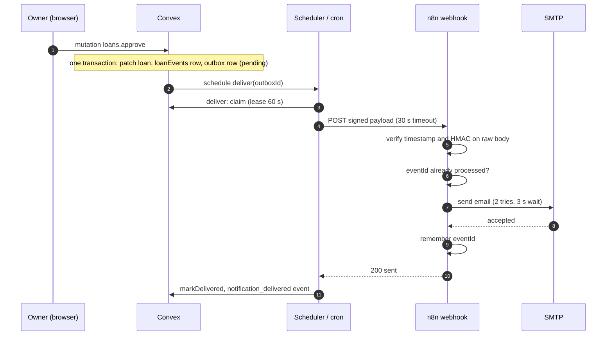
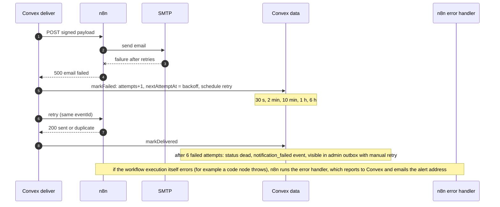
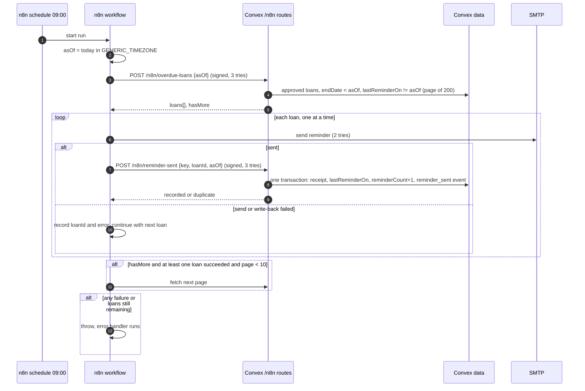
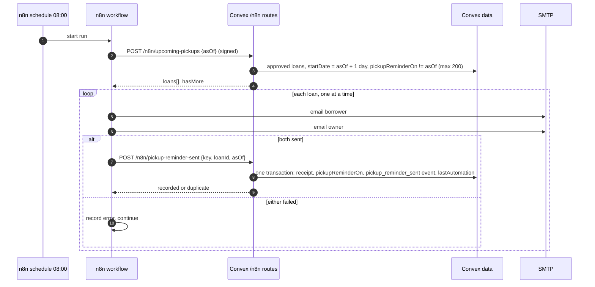
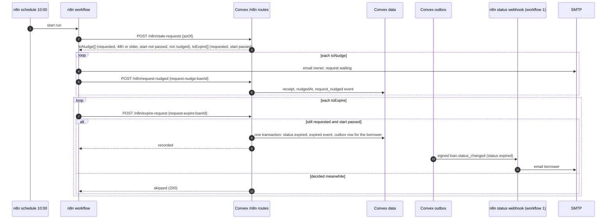
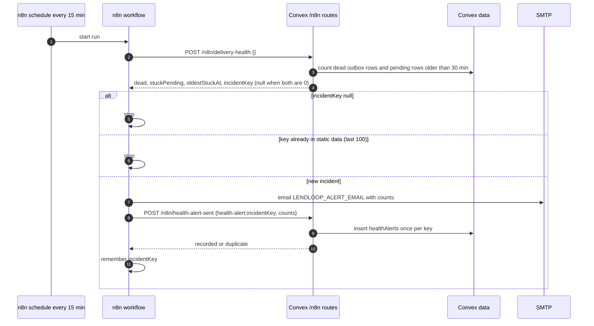
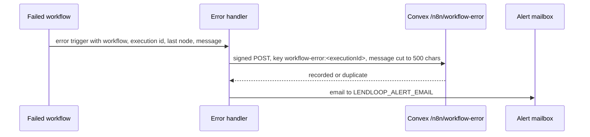

# Architecture

This document goes deeper than the README on the data model, the delivery pipeline and the n8n contract. Everything here is taken from `convex/` and `n8n/workflows/`.

## Responsibilities

| Component | Owns |
|-|-|
| Next.js | Pages, Clerk proxy in `src/proxy.ts` (everything except `/`, `/sign-in`, `/sign-up` requires sign-in), UI state |
| Clerk | Identity, sessions, the `convex` JWT |
| Convex | All data, all authorization, loan rules, the outbox, the cron sweep, signed HTTP routes for n8n |
| n8n | Rendering and sending email, the daily schedule, reporting its own failures. It holds no business state except a short list of processed event ids |

The rule that keeps this simple: Convex decides what is true and what must be sent; n8n only performs delivery and reports back. n8n never reads the database and never changes a loan, apart from recording that a reminder went out.

## Data model

| Table | Key fields | Notes |
|-|-|-|
| `users` | `tokenIdentifier`, `name`, `email`, `role` (`admin` or `user`) | Created on first sign-in by `users.store`. Index `by_token`, `by_email`. Role is only set at creation |
| `tools` | `ownerId`, `name`, `description`, `category`, `condition`, `status` (`active` or `archived`) | Search index on `name`, filterable by status and category. Archived tools stay for history |
| `loans` | `toolId`, `ownerId`, `borrowerId`, `startDate`, `endDate` (`YYYY-MM-DD`), `status`, `note`, `lastReminderOn`, `reminderCount`, `pickupReminderOn`, `nudgedAt`, `lastAutomationAt`, `lastAutomationType` | `status` also has `expired` (set by automation only). `pickupReminderOn` (date) and `nudgedAt` mark that the pickup reminder or owner nudge was already sent. `ownerId` is copied from the tool at request time. Index `by_tool_status` (overlap checks), `by_borrower`, `by_owner`, `by_status_endDate` (overdue scan) |
| `loanEvents` | `loanId`, `at`, `actorType` (`user`, `automation`, `system`), `actorId`, `type`, `detail` | Append-only timeline. Types: the statuses plus `notification_delivered`, `notification_failed`, `reminder_sent`, `pickup_reminder_sent`, `request_nudged`, `expired` |
| `outbox` | `eventId`, `loanId`, `payload`, `status` (`pending`, `delivered`, `dead`), `attempts`, `nextAttemptAt`, `lastError` | One row per status notification. Index `by_status`, `by_status_nextAttemptAt` |
| `webhookReceipts` | `idempotencyKey`, `kind`, `loanId`, `receivedAt` | Dedupe record for inbound n8n calls. Index `by_key` |
| `healthAlerts` | `incidentKey`, `dead`, `stuckPending`, `oldestStuckAt`, `sentAt` | One row per alerted outbox incident. Index `by_key`, `by_sent`. Latest 50 shown in the admin Health alerts tab |
| `automationErrors` | `workflowName`, `nodeName`, `executionId`, `message`, `idempotencyKey` | Failures reported by the n8n error handler. Shown in the admin console |

Design choices:

- `lastAutomationAt` and `lastAutomationType` on `loans` are denormalized from the event log. Every insert of an automation event (`notification_delivered`, `notification_failed`, `reminder_sent`, `pickup_reminder_sent`, `request_nudged`, `expired`) patches them in the same mutation. List views then show "Reminder sent 2 days ago" from the loan row alone, instead of reading the event table once per row (up to 200 rows per list). The cost is one extra patch per automation event and a second place that must stay in sync, which is why it lives in the single event-insert helper. The event log stays the source of truth.
- Dates are plain strings, not timestamps. A loan covers whole calendar days, and string comparison on ISO dates sorts correctly and is easy to index. The cost is that "today" is defined by the server in UTC.
- Overlap is checked against approved loans only. Pending requests may overlap each other, and the second approval is rejected at approval time.
- `loanEvents` stores references and short details, never email addresses.

## Transition pipeline

A loan transition is a single Convex mutation. In one transaction it:

1. Authorizes the actor and checks the current status.
2. Patches the loan.
3. Inserts the `loanEvents` row.
4. Builds the notification payload and inserts the `outbox` row (`pending`, `attempts: 0`, `nextAttemptAt: now`).
5. Schedules `notifications.deliver` for immediately.

Because the outbox row is written in the same transaction as the state change, a transition cannot happen without its notification being recorded, and a failure to reach n8n cannot roll back or block the user's action. If the recipient has no email address, no outbox row is created and a `notification_failed` event is written instead.

Recipient rule: `requested` and `cancelled` notify the owner; `approved`, `declined` and `returned` notify the borrower.

Payload (`loan.status_changed`): `eventId` (UUID), `occurredAt`, `loan` (`id`, `status`, `previousStatus`, `startDate`, `endDate`), `tool.name`, `recipient` (`firstName`, `email`), `link`.

## Outbox delivery

`notifications.deliver` is an action that sends one row:

1. Load the row. Stop if it is not `pending`.
2. `claim`: a mutation that checks the row is pending and due (`nextAttemptAt` not later than now plus 1 s), then moves `nextAttemptAt` 60 seconds ahead. This is the lease. A second `deliver` run or the sweep sees a not-due row and returns, so a row is not sent twice in parallel.
3. If `N8N_LOAN_STATUS_WEBHOOK_URL` or `LENDLOOP_OUTBOUND_SECRET` is missing, call `markUnconfigured`: record the reason, push `nextAttemptAt` 10 minutes out, do not count an attempt.
4. Sign `"<timestamp>.<body>"` and POST with a 30 second timeout. Headers: `X-LendLoop-Event-Id`, `X-LendLoop-Timestamp`, `X-LendLoop-Signature`.
5. 2xx: `markDelivered` sets `delivered`, increments attempts, writes a `notification_delivered` event.
6. Anything else: `markFailed` with `http <status>`, `timeout` or `network error`.

Backoff in `markFailed`: attempt 1 retries after 30 s, then 2 min, 10 min, 1 h, 6 h. On the sixth failed attempt the row becomes `dead` and a `notification_failed` event ("gave up after 6 attempts") is written. Total retry window is a little over seven hours.

The lease (60 s) is deliberately longer than the HTTP timeout (30 s) so a row in flight is not picked up by the sweep. The timeout is deliberately longer than n8n's own email retries (2 tries, 3 s wait) so Convex does not time out while n8n is still legitimately working.

Sweep: `crons.ts` runs `notifications.sweepPending` every 5 minutes. It takes up to 100 pending rows with `nextAttemptAt` in the past and schedules `deliver` for each. This recovers rows whose scheduled job was lost (deployment restart, crash between claim and result) and rows deferred for missing config.

Admin retry: `admin.retryDelivery` resets a `pending` or `dead` row to `pending` with zero attempts and schedules a delivery. Delivered rows cannot be retried, and a row whose delivery claim (`claimedUntil`) is still active is refused so a manual retry cannot double-send.

Guarantee: at least once. n8n's event-id check makes a repeat harmless in the normal case.

## Idempotency keys

| Direction | Key | Stored where | Behaviour on repeat |
|-|-|-|-|
| Convex to n8n | `eventId` (UUID per outbox row) | n8n workflow static data, last 500 ids | `200 {"status":"duplicate"}`, no second email |
| n8n to Convex, reminder | `overdue-reminder:<loanId>:<YYYY-MM-DD>` | `webhookReceipts` | `200 {"status":"duplicate"}`, no second increment |
| n8n to Convex, pickup reminder | `pickup-reminder:<loanId>:<YYYY-MM-DD>` | `webhookReceipts` | `duplicate`, no second event |
| n8n to Convex, owner nudge | `request-nudge:<loanId>` | `webhookReceipts` | `duplicate`, `nudgedAt` unchanged |
| n8n to Convex, expiry | `request-expire:<loanId>` | `webhookReceipts` | `duplicate`; `skipped` if the loan is no longer requested |
| n8n to Convex, health alert | `health-alert:<incidentKey>` | `webhookReceipts` and `healthAlerts` | `duplicate`, one alert row per incident |
| n8n to Convex, error | `workflow-error:<executionId>` | `webhookReceipts` | `200`, one `automationErrors` row only |

For reminders the key is validated against the loan id and date in the body, and the receipt insert, `lastReminderOn` patch, `reminderCount` increment and `reminder_sent` event are one transaction. `/n8n/overdue-loans` also filters out loans whose `lastReminderOn` equals the requested day, so a second run on the same day finds nothing to send even if receipts were lost.

## Request authentication

Both directions: `X-LendLoop-Signature: v1=hex(HMAC_SHA256(secret, timestamp + "." + rawBody))`, `X-LendLoop-Timestamp` in unix seconds, tolerance 300 seconds each way. The timestamp must be 1 to 12 digits. Direction secrets differ.

Each direction also accepts an optional previous secret (`LENDLOOP_INBOUND_SECRET_PREVIOUS` in Convex, `LENDLOOP_OUTBOUND_SECRET_PREVIOUS` in n8n) so a secret can be rotated with an overlap window. Signing uses the current secret only; verification tries each configured secret and ignores an empty one. The runbook is in the README.

Convex side (`convex/http.ts`): reject on declared `Content-Length` over 64 KiB, read the stream with a running byte count and abort over the cap, verify the signature on the raw text, only then `JSON.parse`, then validate each field. Order of failure responses: 413, 401, 400.

n8n side (`Verify signature` node): reads the raw body (the webhook has `rawBody` enabled), applies the same timestamp window, compares with `timingSafeEqual` and rejects a missing `LENDLOOP_OUTBOUND_SECRET` (the previous secret is tried as well when set). It also requires a string `eventId` and a non-blank recipient email (400 otherwise).

`scripts/sign-request.mjs` implements the same scheme for manual testing.

## Sequence: status notification

Error path:

Responses from n8n to the webhook: 200 `sent`, 200 `duplicate`, 401 `unauthorized`, 400 `invalid payload`, 500 `email failed`. Only 200 marks a row delivered. A 400 or 401 is retried like any failure and ends up dead, which surfaces misconfiguration (wrong secret) in the admin outbox instead of hiding it.

## Sequence: overdue reminder with write-back

Failure handling:

- The write-back follows each send immediately, not at the end of the batch, so a later failure cannot cause already-sent borrowers to be emailed again on the next run of the same day.
- If the email is sent but the write-back fails after its retries, the loan is recorded as failed and left without a receipt. A rerun on the same day sends that borrower one more reminder. This is the accepted trade-off of at-least-once delivery.
- Paging only continues while a page produced at least one success. Otherwise the same failing loans would fill every page.
- Failures are accumulated and the run is failed at the end, which triggers the error workflow. One bad address never blocks the others.

## Sequence: pickup reminder

The write-back happens only after both emails went out. If the owner email fails after the borrower email succeeded, the next run repeats both; one duplicate borrower email is the accepted cost of never skipping a reminder. Filtering on `pickupReminderOn` before the 200 limit keeps already-reminded loans from filling the page.

## Sequence: stale follow-up with expiry

Expiry is a normal status transition, so the borrower email goes through the same outbox, retry and dead-letter path as every other notification. This workflow never emails for expiry. `skipped` is a 200 so n8n does not fail a run because the owner decided first.

## Sequence: delivery health monitor with incident dedupe

The incident key is the first 16 hex characters of a SHA-256 over the sorted ids of the dead and stuck rows. The same set of problem rows keeps the same key, so the 15-minute schedule alerts once per incident; the set changing (a new dead row, or one resolved) produces a new key. Two layers dedupe: n8n static data avoids repeat emails, and the `healthAlerts` receipt makes the write-back idempotent if static data is lost. The key is remembered only after the write-back, so a failed run alerts again on the next tick.

## Error reporting

Both steps retry 3 times and continue on error, in that order: the Convex record is written first because it is the one admins can always see.

## Frontend notes

Pages: `/` (public catalog), `/tools/[id]`, `/tools/new`, `/tools/[id]/edit`, `/dashboard`, `/loans/[id]`, `/admin`, and the Clerk sign-in and sign-up routes. Data comes from Convex live queries, so request status, timeline entries and outbox state update without a refresh.
